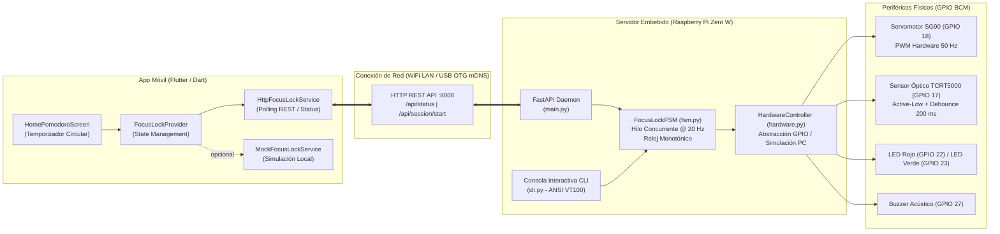
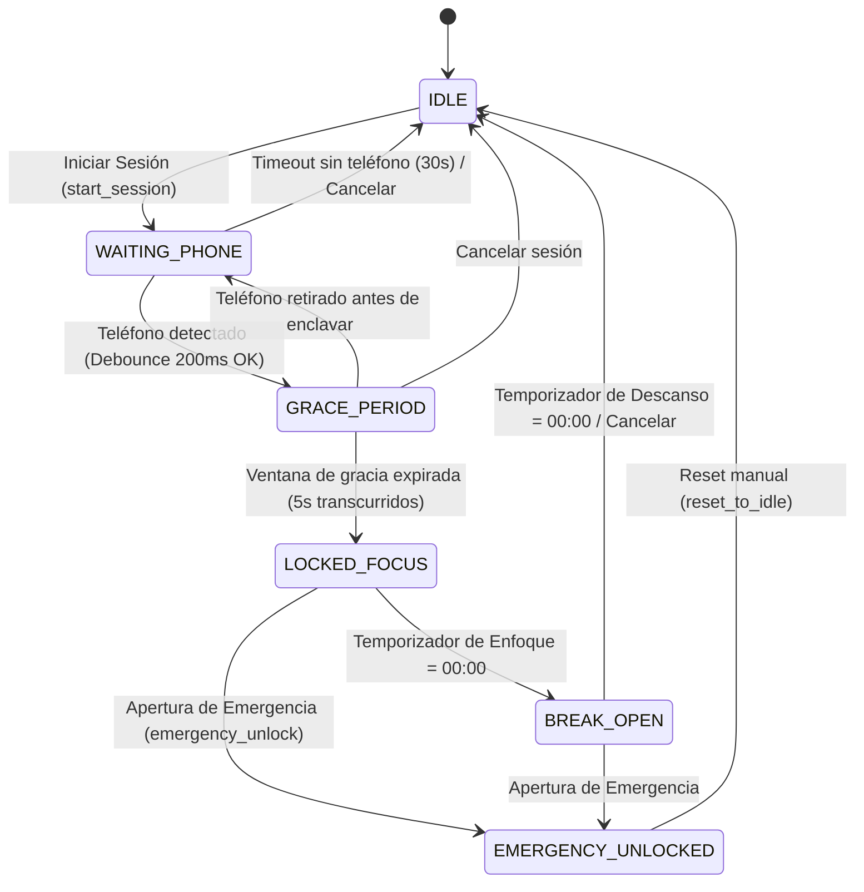

# 🔒 FocusLock — Estación Física Inteligente de Enfoque Pomodoro

> **Proyecto de Electrónica Digital III**  
> *Sistema Embebido de Enclavamiento Físico con Servomotor PWM, Sensor Óptico con Debounce, FSM Concurrente, Servidor REST en Raspberry Pi Zero W y App Móvil Flutter.*

---

## 📋 Tabla de Contenidos
1. [Descripción General](#-descripción-general)
2. [Arquitectura General del Sistema](#-arquitectura-general-del-sistema)
3. [Esquema de Conexiones Físicas (Pinout de la Raspberry Pi)](#-esquema-de-conexiones-físicas-pinout)
4. [Fundamentación Técnica y Cálculos de Hardware (HAL)](#-fundamentación-técnica-y-cálculos-de-hardware-hal)
   - [Control PWM del Servomotor SG90](#1-control-pwm-del-servomotor-sg90-gpio-18)
   - [Sensor Óptico TCRT5000 y Filtro Antirrebote](#2-sensor-óptico-tcrt5000-y-filtro-antirrebote-gpio-17)
   - [Señalización Audiovisual (LEDs y Buzzer)](#3-señalización-audiovisual-leds-y-buzzer)
   - [Capa de Abstracción de Hardware (HAL)](#-capa-de-abstracción-de-hardware-hal)
5. [Máquina de Estados Finita (FSM)](#-máquina-de-estados-finita-fsm)
   - [Diagrama de Transición de Estados](#diagrama-de-transición-de-estados)
   - [Descripción Detallada de Estados](#descripción-detallada-de-estados)
6. [Módulo Servidor Embebido (`focuslock_server`)](#-módulo-servidor-embebido-focuslock_server)
   - [Punto de Entrada Unificado (`main.py`)](#punto-de-entrada-unificado-mainpy)
   - [Consola Interactiva de Telemetría CLI (`cli.py`)](#consola-interactiva-de-telemetría-cli-clipy)
   - [Servicio API REST (FastAPI) y Endpoints](#servicio-api-rest-fastapi)
   - [Servicio Autónomo `systemd` para Raspberry Pi](#servicio-autónomo-systemd-para-raspberry-pi)
7. [Guía de Conexión y Puesta en Marcha](#-guía-de-conexión-y-puesta-en-marcha)
   - [Conexión Física de la Raspberry Pi Zero W (USB OTG vs Wi-Fi)](#1-conexión-física-de-la-raspberry-pi-zero-w)
   - [Despliegue e Instalación en la Raspberry Pi](#2-despliegue-e-instalación-en-la-raspberry-pi)
   - [Ejecución en PC de Desarrollo (Simulación Determinista)](#3-ejecución-en-pc-de-desarrollo-simulación-determinista)
8. [Módulo Aplicación Móvil (`focuslock_mobile`)](#-módulo-aplicación-móvil-focuslock_mobile)
   - [Arquitectura en Flutter](#arquitectura-en-flutter)
   - [Modos de Conexión: Real HTTP vs Mock Service](#modos-de-conexión-real-http-vs-mock-service)
   - [Interfaz de Usuario y Componentes](#interfaz-de-usuario-y-componentes)
   - [Ejecución de la App Móvil](#ejecución-de-la-app-móvil)
9. [Estructura del Proyecto en el Repositorio](#-estructura-del-proyecto-en-el-repositorio)
10. [Estado Actual y Funcionalidades Implementadas](#-estado-actual-y-funcionalidades-implementadas)

---

## 🎯 Descripción General

**FocusLock** es un sistema mecatrónico y digital integral diseñado para combatir la procrastinación y la dependencia al teléfono inteligente durante sesiones de estudio o trabajo profundo. 

A diferencia de las aplicaciones tradicionales de software que pueden cerrarse o desinstalarse con facilidad, FocusLock implementa un **bloqueo físico motorizado**:
1. El usuario configura una sesión Pomodoro (por ejemplo, 25 minutos de enfoque y 5 minutos de descanso) desde su smartphone o la consola interactiva.
2. El sistema exige colocar el teléfono celular dentro del compartimento físico, verificado mediante un **sensor óptico infrarrojo TCRT5000**.
3. Tras una **ventana de gracia preventiva de 5 segundos** con señalización acústica rítmica, un servomotor enclava mecánicamente la compuerta a $90^\circ$.
4. El compartimento permanece físicamente bloqueado durante todo el intervalo de concentración, liberándose automáticamente al iniciar el receso o ante una solicitud explícita de apertura de emergencia.

El proyecto está diseñado bajo una arquitectura de **doble plataforma**:
- **Hardware Embebido**: Servidor daemon autónomo desarrollado en Python 3 para **Raspberry Pi Zero W** (SoC BCM2835), que gestiona directamente los periféricos por GPIO, ejecuta la Máquina de Estados Finita (FSM) a 20 Hz e integra un servidor API REST y una consola interactiva CLI ANSI.
- **Cliente Móvil**: Aplicación multiplataforma desarrollada en **Flutter**, con gestión reactiva de estado (Provider), visualización de temporizador circular y soporte para operar tanto conectado a la Raspberry Pi en red local (mDNS/IP) como en modo simulado para pruebas aisladas.

---

## 🏗️ Arquitectura General del Sistema



---

## 🔌 Esquema de Conexiones Físicas (Pinout — Raspberry Pi 4 Model B)

La siguiente tabla resume el conexionado físico entre los módulos electrónicos y la regleta estándar de 40 pines de la **Raspberry Pi 4 Model B** (y Pi Zero W):

| Periférico | Pin BCM | Pin Físico | Nivel / Alimentación | Función / Descripción Técnica |
| :--- | :---: | :---: | :---: | :--- |
| **Servo 1 — Tapa / Compuerta (Señal)** | `GPIO 18` | **Pin 12** | PWM0 Hardware (3.3V) | Modulación PWM a 50 Hz. Abre (0° / 1.0 ms) y Cierra la tapa (90° / 2.0 ms). |
| **Servo 2 — Bloqueo / Cerrojo (Señal)** | `GPIO 13` | **Pin 33** | PWM1 Hardware (3.3V) | Modulación PWM a 50 Hz. Desbloquea (0° / 1.0 ms) y Bloquea la caja (90° / 2.0 ms). |
| **Alimentación Servos (VCC)** | — | **Marranita Externa** | 5.0V (Ext) | Alimentación externa recomendada (evita caídas de tensión y reinicios de la Pi). |
| **Alimentación Servos (GND)** | — | **Pin 6, 14 o 39** | GND Común | Tierra común unida entre fuente externa y Raspberry Pi. |
| **Sensor TCRT5000 / HW-201 (D0)** | `GPIO 17` | **Pin 11** | Entrada Digital (3.3V) | Lógica activa en bajo (*Active-Low*, 0V con teléfono) con Pull-Up interno activado. |
| **Sensor TCRT5000 (VCC / GND)** | — | **Pin 1 (3.3V) / Pin 9** | 3.3V / GND | Alimentación del comparador óptico. |
| **LED Rojo (Enfoque / Bloqueado)** | `GPIO 22` | **Pin 15** | Salida Digital (3.3V) | Ánodo con resistencia de $220\Omega$; cátodo a GND (Pin 14). |
| **LED Verde (Libre / Abierto)** | `GPIO 23` | **Pin 16** | Salida Digital (3.3V) | Ánodo con resistencia de $220\Omega$; cátodo a GND (Pin 14). |
| **Buzzer Activo (+)** | `GPIO 27` | **Pin 13** | Salida Digital (3.3V) | Terminal (+) a GPIO 27; Terminal (-) a GND (Pin 14). Bips en cuenta regresiva. |
| **Pantalla LCD 16x2 I2C (SDA)** | `GPIO 2` | **Pin 3** | I2C Data (3.3V) | Comunicación I2C dirección 0x27 / 0x3F. |
| **Pantalla LCD 16x2 I2C (SCL)** | `GPIO 3` | **Pin 5** | I2C Clock (3.3V) | Reloj I2C. Muestra estado FSM, cuenta regresiva y avisos de cierre. |
| **Pantalla LCD (VCC / GND)** | — | **Pin 2 (5V) / Pin 6 (GND)** | 5.0V / GND | Alimentación del módulo LCD I2C. |

---

## ⚡ Fundamentación Técnica y Cálculos de Hardware (HAL)

Todo el control de periféricos se implementa en el archivo [focuslock_server/hardware.py](file:///c:/Users/paula/OneDrive/Documentos/PROYECTOS/Focuslock/focuslock_server/hardware.py). La capa incluye detección automática del entorno: si se ejecuta en la Raspberry Pi utiliza la librería `RPi.GPIO`, y si se ejecuta en una PC de desarrollo activa un subsistema de emulación determinista.

### 1. Control PWM del Servomotor SG90 (GPIO 18)
El servomotor de bloqueo se controla mediante modulación por ancho de pulsos (**PWM**) a través del pin GPIO 18 (canal nativo PWM0 del SoC BCM2835):

* **Frecuencia de la portadora PWM:**
  $$f_{\text{pwm}} = 50\text{ Hz}$$
* **Periodo de la señal ($T$):**
  $$T = \frac{1}{f_{\text{pwm}}} = \frac{1}{50\text{ Hz}} = 0.020\text{ s} = 20.0\text{ ms}$$
* **Relación de Ciclo de Trabajo (Duty Cycle $D$):**
  $$D(\%) = \left(\frac{t_{\text{on}}}{T}\right) \times 100$$
* **Posición Desbloqueada ($0^\circ$ — Cerrojo Retraído):**
  $$t_{\text{on}} = 1.0\text{ ms} \implies D = \left(\frac{1.0\text{ ms}}{20.0\text{ ms}}\right) \times 100 = 5.0\%$$
* **Posición Bloqueada ($90^\circ$ — Cerrojo Enclavado):**
  $$t_{\text{on}} = 2.0\text{ ms} \implies D = \left(\frac{2.0\text{ ms}}{20.0\text{ ms}}\right) \times 100 = 10.0\%$$

> [!IMPORTANT]
> **Mitigación de Jitter y Disipación Térmica en Reposo:**  
> Tras emitir el tren de pulsos durante $t_{\text{settle}} = 400\text{ ms}$ (equivalente a 20 periodos completos de $20\text{ ms}$, tiempo suficiente para que el tren de engranajes del SG90 complete el giro a su velocidad angular nominal de $0.12\text{ s} / 60^\circ$), el software fuerza inmediatamente el ciclo de trabajo a $D = 0.0\%$.  
> Esto desenergiza el puente H interno del servomotor, suprimiendo por completo el temblor mecánico (*jitter*) causado por la cuantización del temporizador del sistema y evitando el sobrecalentamiento del motor en reposo.

---

### 2. Sensor Óptico TCRT5000 y Filtro Antirrebote (GPIO 17)
La detección de presencia del teléfono en la base se realiza mediante un módulo de reflexión infrarroja TCRT5000:

* **Configuración eléctrica:** Pin GPIO 17 configurado como entrada digital con resistencia de **Pull-Up interna habilitada** ($R_{\text{pu}} \approx 50\text{ k}\Omega$ a $3.3\text{ V}$).
* **Lógica Digital:** Activa en bajo (*Active-Low*):
  * **Nivel Alto ($3.3\text{ V}$, `GPIO.HIGH`):** No hay reflexión IR suficiente $\rightarrow$ Compartimento **VACÍO**.
  * **Nivel Bajo ($0.0\text{ V}$, `GPIO.LOW`):** Fototransistor saturado por reflexión del chasis del teléfono $\rightarrow$ Teléfono **PRESENTE**.
* **Filtro Antirrebote por Software (Debounce):**
  Para evitar falsos disparos por sombras, vibraciones o inserciones parciales:
  * **Ventana de estabilidad continua requerida:** $t_{\text{debounce}} = 200.0\text{ ms}$.
  * **Base de tiempo:** Uso estricto de `time.monotonic()`, inmune a desfases o sincronizaciones por protocolo NTP.
  * **Criterio de validación:** El estado lógico se valida únicamente cuando:
    $$\Delta t = (t_{\text{actual}} - t_{\text{último\_cambio\_crudo}}) \ge 0.200\text{ s}$$

---

### 3. Señalización Audiovisual (LEDs y Buzzer)
* **LED Rojo (GPIO 22):** Se ilumina exclusivamente cuando el sistema está en `LOCKED_FOCUS` (cerrojo accionado).
* **LED Verde (GPIO 23):** Se ilumina en estados seguros de acceso abierto (`IDLE`, `BREAK_OPEN`, `EMERGENCY_UNLOCKED`).
* **Buzzer (GPIO 27):** Emite secuencias auditivas temporizadas de forma no bloqueante:
  * *Bip corto (100 ms):* Confirmación de inicio de sesión.
  * *Bip doble (200 ms):* Detección confirmada del teléfono en la base o cancelación.
  * *Pulsos continuos en ventana de gracia (5s):* Alerta audible antes del enclavamiento físico.
  * *Tono sostenido (500 ms):* Apertura de emergencia ejecutada.

---

### 🛡️ Capa de Abstracción de Hardware (HAL)
El controlador `HardwareController` expone una interfaz transparente con telemetría en tiempo real:

```python
hw = HardwareController()
hw.lock_door()          # Acciona el servo a 90° con corte de jitter a los 400 ms
hw.unlock_door()        # Retrae el servo a 0° con corte de jitter a los 400 ms
hw.is_phone_detected()  # Consulta el estado del sensor con filtro de debounce de 200 ms
hw.get_telemetry()      # Retorna diccionario con ángulo, voltajes, PWM duty y estados GPIO
```

---

## 🔄 Máquina de Estados Finita (FSM)

Implementada en [focuslock_server/fsm.py](file:///c:/Users/paula/OneDrive/Documentos/PROYECTOS/Focuslock/focuslock_server/fsm.py), la FSM utiliza un modelo híbrido Moore/Mealy ejecutado en un hilo concurrente dedicado (`FocusLock-FSM-Worker`) con un periodo de muestreo $T_s = 50\text{ ms}$ ($20\text{ Hz}$).

### Diagrama de Transición de Estados



### Descripción Detallada de Estados

| Estado (`FSMState`) | Cerrojo | LEDs | Buzzer | Descripción y Comportamiento |
| :--- | :---: | :---: | :---: | :--- |
| **`IDLE`** | $0^\circ$ (Abierto) | Verde ON, Rojo OFF | Silencioso | Estado de reposo. El sistema espera comandos desde la App o la consola CLI. |
| **`WAITING_PHONE`** | $0^\circ$ (Abierto) | Verde ON, Rojo OFF | Bip de inicio | Se inició la sesión. El sistema muestrea el pin GPIO 17 a 20 Hz. Si transcurren 30 segundos sin detectar el teléfono, aborta automáticamente a `IDLE`. |
| **`GRACE_PERIOD`** | $0^\circ$ (Abierto) | Verde ON, Rojo OFF | Pulsos audibles | Ventana de seguridad de 5 segundos. Permite al usuario soltar el teléfono y retirar la mano del compartimento. Si retira el celular en este lapso, regresa a `WAITING_PHONE`. |
| **`LOCKED_FOCUS`** | $90^\circ$ (Enclavado) | Verde OFF, Rojo ON | Bip de bloqueo | **Enfoque bloqueado.** El servomotor enclava el compartimento (con corte PWM a los 400 ms). Se descuenta el tiempo segundo a segundo sin deriva. **No se permiten cancelaciones ordinarias**. |
| **`BREAK_OPEN`** | $0^\circ$ (Abierto) | Verde ON, Rojo OFF | Bip triple | El periodo de enfoque ha concluido con éxito. El cerrojo se abre y corre el temporizador del tiempo de descanso (Break). El usuario puede extraer su móvil. |
| **`EMERGENCY_UNLOCKED`** | $0^\circ$ (Abierto) | Verde ON, Rojo OFF | Bip largo (500 ms) | Desbloqueo forzado por protocolo de seguridad o emergencia. Se cancela la sesión activa y se libera la compuerta de inmediato. |

---

## 🖥️ Módulo Servidor Embebido (`focuslock_server`)

### Punto de Entrada Unificado (`main.py`)
El archivo [focuslock_server/main.py](file:///c:/Users/paula/OneDrive/Documentos/PROYECTOS/Focuslock/focuslock_server/main.py) sirve como punto de acceso único para los dos modos de operación del sistema:
* **Modo API REST:** Ejecución por defecto (`python main.py`), levanta el servidor web FastAPI para enlazar con la App Móvil Flutter.
* **Modo Consola Interactiva:** Flag `--cli` (`python main.py --cli`), inicia el entorno interactivo en terminal con telemetría en tiempo real sin requerir red.

---

### Consola Interactiva de Telemetría CLI (`cli.py`)
Diseñada específicamente para sustentar el funcionamiento del hardware y la lógica digital sin depender de conexiones WiFi o clientes externos:
* **Captura asíncrona de teclado:** Lee pulsaciones directas sin esperar la tecla Enter (`msvcrt` en Windows y `termios/tty` en Linux/Raspberry Pi).
* **Renderizado dinámico ANSI VT100:** Actualiza el panel en pantalla cada 100 ms sin parpadeos (`cursor home`), mostrando el estado de la FSM, temporizador, telemetría PWM del SG90, voltajes y estado del filtro antirrebote.
* **Teclas de control en vivo:**
  * `1` : Iniciar sesión Pomodoro (25m Focus / 5m Break).
  * `p` : Simular colocación / retiro del smartphone en el sensor TCRT5000 (con prueba de debounce de 200 ms).
  * `c` : Cancelar sesión (permitido en estados abiertos).
  * `e` : Disparar apertura de emergencia inmediata.
  * `q` : Salir limpiamente liberando los recursos y pines GPIO.

---

### Servicio API REST (FastAPI)

Expone los siguientes endpoints HTTP en el puerto 8000:

| Método | Endpoint | Parámetros / Cuerpo JSON | Descripción |
| :---: | :--- | :--- | :--- |
| **`GET`** | `/` | — | Comprobación de salud (*healthcheck*) e identificación del servicio. |
| **`GET`** | `/api/status` | — | Retorna el estado instantáneo de la FSM, tiempos y telemetría de hardware. |
| **`POST`** | `/api/session/start` | `{"focus_minutes": 25, "break_minutes": 5}` | Inicia una sesión Pomodoro y pone el sistema en `WAITING_PHONE`. |
| **`POST`** | `/api/session/cancel` | — | Cancela la sesión activa (rechazado con HTTP 400 si está en `LOCKED_FOCUS`). |
| **`POST`** | `/api/hardware/unlock` | `{"auth_token": "opcional"}` | Apertura de emergencia del cerrojo. |
| **`POST`** | `/api/hardware/mock_phone` | `{"detected": true}` | Endpoint para inyectar presencia simulada desde herramientas externas. |

**Ejemplo de respuesta devuelta por `/api/status`:**
```json
{
  "state": "LOCKED_FOCUS",
  "phone_detected": true,
  "raw_phone_detected": true,
  "debounce_elapsed_ms": 200.0,
  "is_locked": true,
  "servo_angle_deg": 90,
  "servo_duty_cycle": 0.0,
  "remaining_seconds": 1498,
  "remaining_formatted": "24:58",
  "focus_minutes": 25,
  "break_minutes": 5,
  "session_id": "pomodoro_1730739000",
  "led_red": true,
  "led_green": false,
  "buzzer_active": false
}
```

---

### Servicio Autónomo `systemd` para Raspberry Pi

Para que el servidor se ejecute automáticamente al energizar la Raspberry Pi Zero W sin requerir comandos manuales:

1. Crear el archivo del servicio del sistema:
   ```bash
   sudo nano /etc/systemd/system/focuslock.service
   ```
2. Pegar la siguiente configuración:
   ```ini
   [Unit]
   Description=FocusLock Embedded Server Daemon
   After=network.target

   [Service]
   Type=simple
   User=paula
   WorkingDirectory=/home/paula/focuslock_server
   ExecStart=/usr/bin/python3 /home/paula/focuslock_server/main.py
   Restart=always
   RestartSec=3
   StandardOutput=journal
   StandardError=journal

   [Install]
   WantedBy=multi-user.target
   ```
3. Activar e iniciar el servicio:
   ```bash
   sudo systemctl daemon-reload
   sudo systemctl enable focuslock.service
   sudo systemctl start focuslock.service
   ```
4. Consultar estado y logs en tiempo real:
   ```bash
   sudo systemctl status focuslock.service
   journalctl -u focuslock.service -f
   ```

---

## 🚀 Guía de Conexión y Puesta en Marcha

### 1. Conexión Física de la Raspberry Pi Zero W

> [!IMPORTANT]
> **Identificación de los Puertos Micro-USB:**  
> La Raspberry Pi Zero W cuenta con **dos puertos micro-USB**:
> - **`PWR IN` (extremo exterior):** Solo conduce corriente. Si conectas el cable aquí, el LED prenderá pero el PC jamás detectará el dispositivo ni transmitirá datos.
> - **`USB` (puerto central / interior):** Es el **puerto OTG de datos**. Para conectar la Raspberry Pi al computador y alimentarla simultáneamente en modo Gadget Ethernet, **debes usar obligatoriamente este puerto central**.
> - **Comportamiento del LED verde (ACT):** Al encenderla, el LED parpadeará durante unos segundos leyendo los archivos de la microSD y luego se apagará o quedará en reposo (comportamiento normal en la Pi Zero, indicando que el kernel cargó).

---

### 2. Despliegue e Instalación en la Raspberry Pi

> [!TIP]
> **Credenciales y Configuración de Red Predefinidas:**
> - **Usuario:** `paula`
> - **Contraseña:** `Sol123`
> - **Hostname / mDNS:** `paula` (`paula.local`)
> - **Red Wi-Fi configurada en SO:** SSID `pau` / Clave `Paloma23`

1. **Acceso remoto por SSH:**
   * **Vía cable USB OTG (Recomendado):** Conecta el cable al puerto central `USB` y a tu PC:
     ```bash
     ssh paula@paula.local
     ```
   * **Vía red local Wi-Fi:**
     ```bash
     ssh paula@paula.local
     # o usando la dirección IP asignada (ejemplo: ssh paula@192.168.1.50)
     ```
   *(Contraseña preconfigurada: `Sol123`).*

2. **Instalación de paquetes base del sistema:**
   ```bash
   sudo apt update
   sudo apt install -y python3-pip python3-rpi.gpio git
   ```

3. **Instalación de librerías Python:**
   ```bash
   cd /home/paula/focuslock_server
   pip3 install -r requirements.txt --break-system-packages
   ```
   *(La bandera `--break-system-packages` es requerida en Raspberry Pi OS Bookworm debido a la especificación PEP 668).*

4. **Ejecución directa:**
   * Modo Servidor REST:
     ```bash
     python3 main.py
     ```
   * Modo Demostración en Vivo CLI:
     ```bash
     python3 main.py --cli
     ```

---

### 3. Ejecución en PC de Desarrollo (Simulación Determinista)

Para validar el sistema en un computador de desarrollo sin tener los componentes físicos conectados:

```bash
cd focuslock_server
pip install -r requirements.txt

# Demostración interactiva CLI:
python main.py --cli

# Servidor REST para pruebas locales:
python main.py
```

*En PC, la capa HAL detecta automáticamente la ausencia de `RPi.GPIO` y sustituye los pines físicos por una emulación en memoria determinista.*

---

## 📱 Módulo Aplicación Móvil (`focuslock_mobile`)

### Arquitectura en Flutter
Desarrollada en Flutter con una arquitectura limpia y orientada a características:
* **`core/models/`**:
  * `FocusLockState`: Enumeración completa con mapeo ergonómico desde las cadenas devueltas por el servidor Python (`fromBackendString`), etiquetas en español, subtítulos explicativos y códigos de color adaptativos.
  * `PomodoroSessionConfig`: Configuración inmutable de tiempos de enfoque y descanso.
  * `FocusLockStatus`: Modelo inmutable representativo del estado completo (conexión, sensor, tiempos restantes, progreso normalizado de 0.0 a 1.0).
* **`core/services/`**:
  * `IFocusLockService`: Contrato abstracto para desacoplar la capa de transporte.
  * `HttpFocusLockService`: Cliente HTTP con sondeo periódico (polling a 1 Hz) y llamadas REST contra la Raspberry Pi (`paula.local:8000`).
  * `MockFocusLockService`: Simulación completa en memoria de la FSM, tiempos y detección de teléfono para pruebas sin hardware.
* **`core/providers/`**:
  * `FocusLockProvider`: `ChangeNotifier` de la librería `Provider` que expone el estado global y centraliza las acciones del usuario.

### Modos de Conexión: Real HTTP vs Mock Service
La app puede alternar entre consumir el hardware real por red local o trabajar en modo simulado:
* **Indicador en barra superior:** Muestra un badge visual dinámico (`Pi Zero W Online` en verde o `Mock Service` en gris) para saber con certeza qué fuente alimenta la interfaz.
* **Tolerancia a fallos de red:** Si la conexión con la Raspberry Pi se interrumpe temporalmente, la interfaz pasa a un estado seguro sin colapsar.

### Interfaz de Usuario y Componentes
* **`CircularPomodoroTimer`**: Widget personalizado que dibuja un temporizador circular animado con gradientes reactivos:
  * Azul cian: Espera / Preparación (`WAITING_PHONE`).
  * Ámbar / Naranja: Ventana de gracia preventiva de 5 segundos (`GRACE_PERIOD`).
  * Rojo carmesí: Enfoque bloqueado (`LOCKED_FOCUS`).
  * Verde menta: Descanso liberado (`BREAK_OPEN`).
* **Controles contextuales dinámicos:** Los botones se adaptan al estado de la FSM: selectores de tiempo en `IDLE`, aviso de retiro de manos en `GRACE_PERIOD`, candado informativo en `LOCKED_FOCUS` y diálogo con confirmación para aperturas de emergencia.

### Ejecución de la App Móvil
```bash
cd focuslock_mobile
flutter pub get
flutter run
```

---

## 📁 Estructura del Proyecto en el Repositorio

```text
Focuslock/
├── README.md                           # 📖 Documentación técnica unificada y completa del proyecto
│
├── focuslock_server/                   # 🐍 Backend embebido, controladores de hardware y CLI
│   ├── main.py                         # Punto de entrada unificado (FastAPI / flag --cli)
│   ├── fsm.py                          # Máquina de Estados Finita concurrente (20 Hz)
│   ├── hardware.py                     # Capa HAL (PWM SG90, TCRT5000 debounce, LEDs, Buzzer)
│   ├── cli.py                          # Panel de instrumentación y telemetría interactiva ANSI
│   └── requirements.txt                # Dependencias Python (FastAPI, Uvicorn, Pydantic)
│
└── focuslock_mobile/                   # 📱 Aplicación móvil cliente en Flutter
    ├── pubspec.yaml                    # Dependencias Flutter (Provider, Http, GoogleFonts)
    ├── lib/
    │   ├── main.dart                   # Punto de inicio de la aplicación Flutter
    │   ├── core/
    │   │   ├── constants/              # Paleta de colores (AppColors) y constantes
    │   │   ├── models/                 # Modelos de dominio (FocusLockState, FocusLockStatus)
    │   │   ├── providers/              # Gestión de estado reactivo (FocusLockProvider)
    │   │   ├── routes/                 # Enrutamiento de la aplicación
    │   │   ├── services/               # Clientes HttpFocusLockService y MockFocusLockService
    │   │   └── theme/                  # Configuración de tema visual oscuro (AppTheme)
    │   ├── features/
    │   │   ├── connection/             # Pantalla de ajuste de conexión y mDNS
    │   │   ├── history/                # Historial de sesiones de enfoque
    │   │   ├── pomodoro/               # Pantalla principal (HomePomodoroScreen)
    │   │   └── settings/               # Ajustes y configuración general
    │   └── shared/
    │       └── widgets/                # Componentes reusables (CircularPomodoroTimer)
    └── test/                           # Pruebas unitarias y de widgets
```

---

## 📊 Estado Actual y Funcionalidades Implementadas

| Componente | Funcionalidad | Estado | Observaciones Técnicas |
| :--- | :--- | :---: | :--- |
| **Hardware HAL** | Control PWM Servo SG90 | ✅ **100%** | Portadora de 50 Hz, $0^\circ$ (5%) y $90^\circ$ (10%) con corte a 400 ms contra jitter. |
| **Hardware HAL** | Sensor TCRT5000 + Debounce | ✅ **100%** | Pull-Up interno, lógica Active-Low, filtro monotónico de 200 ms a 20 Hz. |
| **Hardware HAL** | Señalización LED / Buzzer | ✅ **100%** | Control no bloqueante de pulsos auditivos y alarmas de emergencia. |
| **Hardware HAL** | Simulación transparente en PC | ✅ **100%** | Fallback automático cuando `RPi.GPIO` no está presente. |
| **Lógica FSM** | 6 Estados y Transiciones | ✅ **100%** | Modelo Moore/Mealy concurrente en hilo daemon libre de deriva temporal. |
| **Lógica FSM** | Ventana de Gracia (5s) | ✅ **100%** | Confirmación acústica antes de enclavamiento físico para seguridad del usuario. |
| **Backend API** | Endpoints REST en FastAPI | ✅ **100%** | Rutas `/status`, `/start`, `/cancel`, `/unlock` y `/mock_phone` documentadas. |
| **Backend CLI** | Panel interactivo en terminal | ✅ **100%** | Renderizado ANSI VT100 y captura asíncrona de teclas para sustentación. |
| **App Flutter** | Modelos y FSM State Mapping | ✅ **100%** | `FocusLockState` mapea de forma idéntica los estados del backend. |
| **App Flutter** | Provider y Reactividad | ✅ **100%** | Gestión centralizada de estado con `FocusLockProvider`. |
| **App Flutter** | Temporizador Circular Animado | ✅ **100%** | Componente visual `CircularPomodoroTimer` con paleta de color adaptativa. |
| **App Flutter** | Servicios HTTP y Mock Dual | ✅ **100%** | Capacidad de operar conectado a la Raspberry Pi real o en modo simulador. |
